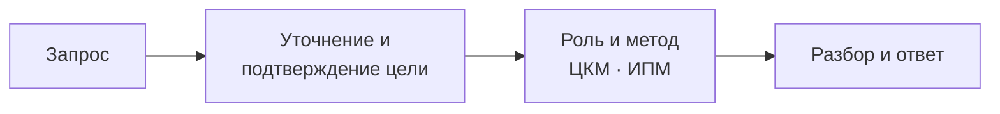
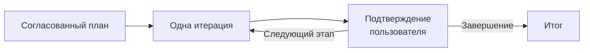

# 🧠 Family Meta Machine

**Семейство Custom GPT с общим протоколом диалога**

Уточнение цели, выбор стратегии и пошаговый разбор с участием пользователя.

[Открыть сайт](https://meta-machine.vercel.app/#home) · [Инструкции и FAQ](https://meta-machine.vercel.app/#guide) · [Архитектура](https://meta-machine.vercel.app/#architecture) · [Примеры диалогов](#примеры-диалогов)

  

Модули и маршрут запроса Meta Machine

---

## О проекте

**Family Meta Machine** — авторский эксперимент по управлению поведением GPT через модульную систему инструкций. Общее ядро задаёт порядок диалога, а специализированные роли адаптируют его для обучения, исследований, проектирования и других задач.

Отправная точка — простая проблема: подробный ответ может оказаться ответом не на тот вопрос. Поэтому система сначала выясняет намерение пользователя, согласует направление и только затем переходит к содержательному разбору. В многошаговой работе пользователь управляет переходами между этапами.

| Задача | Решение в системе |
|---|---|
| Уточнить, что человек хочет получить | Обязательная проверка намерения в начале диалога, новой задачи или при смене цели |
| Выбрать подход к вопросу | Ролевой профиль и шесть шаблонов разбора |
| Удерживать направление работы | Центр когнитивной маршрутизации: цель, метод, глубина, стиль и прогресс |
| Разобрать объёмную тему по частям | Согласованный план и отдельные сообщения для итераций |
| Сделать результат удобным для чтения | Правила структуры, детализации и оформления ответа |

## Как проходит запрос

Итерационный режим предназначен уже для задач средней сложности, которые требуют нескольких содержательных сообщений. План согласуется отдельно; после каждой итерации, включая последнюю, система запрашивает подтверждение продолжения.

<strong>Модули и исходные инструкции</strong>

| Модуль | За что отвечает |
|---|---|
| [Правила запуска](00_Instructions.md) | Вход в диалог, порядок подключения компонентов и приоритет правил |
| [Ролевой профиль](00_Role_Definition_Layer.md) | Назначение роли и её исходные настройки |
| [ЦКМ — центр когнитивной маршрутизации](00_Cognitive_Routing_Center.md) | Единое состояние сессии: параметры, флаги и прогресс |
| [Принципы взаимодействия](01_Core_Principles_of_Interaction.md) | Работа с намерением, контекстом и обратной связью |
| [ИПМ — интеллектуальный процессор мышления](02_Core_Cognitive_Processor.md) | Выбор метода, организация разбора и обновление состояния |
| [Каталог шаблонов](03_Core_Template_List.md) | Шесть стратегий обработки запросов |
| [План итераций](04_Core_Iteration_Plan.md) | Декомпозиция и управляемые переходы между этапами |
| [Оформление ответа](05_Core_Text_Styling_Rules.md) | Структура текста и визуальная навигация |
| [Нотация DLS](Spec_Slang_DLS.md) | Обозначения слоёв, приоритетов, ссылок и директив |

[Исторический Firewall](00_Security_Check.md) сохранён отдельно и отключён в текущем протоколе.

## Стратегии разбора

| Стратегия | Когда полезна |
|---|---|
| Итерационный анализ | Разложить тему на этапы и последовательно проверить выводы |
| Диалоговое исследование | Сопоставить позиции, гипотезы и контраргументы |
| Концептуальный разбор | Упорядочить понятия, связи и уровни задачи |
| Интерактивный вызов | Найти альтернативы и проверить привычную точку зрения |
| Потоковый анализ | Развить ассоциации и исследовать ещё не оформленную идею |
| Адаптивное погружение | Уточнять подход по мере появления новых вводных |

## Роли и использование

На [сайте проекта](https://meta-machine.vercel.app/#home) собраны десять конфигураций Custom GPT:

| Роли | Направление |
|---|---|
| Meta Machine | Универсальная точка входа и уточнение задачи |
| Research · Sense · Analyst | Исследование, осмысление и анализ |
| Creative · Design | Идеи, концепции и проектирование |
| Code | Инженерные задачи и работа с кодом |
| Education | Обучение и персональные учебные маршруты |
| Strategy · Trader | Стратегии, сценарии и оценка рисков |

Выберите роль на сайте и откройте её в ChatGPT. Опишите задачу, ответьте на уточнение и согласуйте направление работы. Для объёмной темы система предложит план, по которому можно двигаться шаг за шагом.

## Технологии и подход

| Основа | Применение |
|---|---|
| OpenAI Custom GPT | Среда работы специализированных конфигураций |
| Markdown | Хранение и организация инструкций |
| DLS | Авторская нотация для описания правил и связей между модулями |
| Модульные инструкции | Роли, маршрутизация, шаблоны анализа и управление итерациями |

Параметры в файлах, в том числе `temperature`, глубина и ресурсы анализа, описывают желаемое поведение через инструкции. Это настройки протокола диалога, а не прямое управление вычислениями модели.

## Примеры диалогов

Материалы разработки на GPT-4o, o3 и GPT-5: знакомство с системой, учебные сценарии и сравнения ответов разных конфигураций.

### Знакомство

<table align="center" width="100%">
  <tbody>
    <tr>
      <td align="center" valign="top" width="33%"></td>
      <td align="center" valign="top" width="33%"></td>
      <td align="center" valign="top" width="33%"></td>
    </tr>
  </tbody>
</table>

<strong>Примеры использования</strong>

### Общие примеры

<table align="center" width="100%">
  <tbody>
    <tr>
      <td align="center" valign="top" width="33%"></td>
      <td align="center" valign="top" width="33%"></td>
      <td align="center" valign="top" width="33%"></td>
    </tr>
  </tbody>
</table>

### Персональный курс английского

<table align="center" width="100%">
  <tbody>
    <tr>
      <td align="center" valign="top" width="33%"></td>
      <td align="center" valign="top" width="33%"></td>
      <td align="center" valign="top" width="33%"></td>
    </tr>
  </tbody>
</table>

### Работа с кратким запросом

<table align="center" width="100%">
  <tbody>
    <tr>
      <td align="center" valign="top" width="33%"></td>
      <td align="center" valign="top" width="33%"></td>
      <td align="center" valign="top" width="33%"></td>
    </tr>
  </tbody>
</table>

<strong>Сравнение конфигураций и оценки ответов</strong>

<table align="center" width="100%">
  <tbody>
    <tr>
      <td align="center" valign="top" width="33%"></td>
      <td align="center" valign="top" width="33%"></td>
      <td align="center" valign="top" width="33%"></td>
    </tr>
    <tr>
      <td align="center" valign="top" width="33%"></td>
      <td align="center" valign="top" width="33%"></td>
      <td align="center" valign="top" width="33%"></td>
    </tr>
    <tr>
      <td align="center" valign="top" width="33%"></td>
      <td align="center" valign="top" width="33%"></td>
      <td width="33%"></td>
    </tr>
  </tbody>
</table>

<strong>Учебные сценарии: Education Machine и режим «Учёба»</strong>

### GPT-5 в режиме «Учёба»

<table align="center" width="100%">
  <tbody>
    <tr>
      <td align="center" valign="top" width="50%"></td>
      <td align="center" valign="top" width="50%"></td>
    </tr>
  </tbody>
</table>

### Education Machine + GPT-5

<table align="center" width="100%">
  <tbody>
    <tr>
      <td align="center" valign="top" width="33%"></td>
      <td align="center" valign="top" width="33%"></td>
      <td align="center" valign="top" width="33%"></td>
    </tr>
  </tbody>
</table>

### Education Machine + o3

<table align="center" width="100%">
  <tbody>
    <tr>
      <td align="center" valign="top" width="33%"></td>
      <td align="center" valign="top" width="33%"></td>
      <td align="center" valign="top" width="33%"></td>
    </tr>
  </tbody>
</table>

### Education Machine + GPT-4o

<table align="center" width="100%">
  <tbody>
    <tr>
      <td align="center" valign="top" width="33%"></td>
      <td align="center" valign="top" width="33%"></td>
      <td align="center" valign="top" width="33%"></td>
    </tr>
  </tbody>
</table>

<strong>Сравнение диалогов с Meta Machine и без неё</strong>

### Базовая GPT

<table align="center" width="100%">
  <tbody>
    <tr>
      <td align="center" valign="top" width="33%"></td>
      <td align="center" valign="top" width="33%"></td>
      <td align="center" valign="top" width="33%"></td>
    </tr>
  </tbody>
</table>

### Meta Machine

<table align="center" width="100%">
  <tbody>
    <tr>
      <td align="center" valign="top" width="33%"></td>
      <td align="center" valign="top" width="33%"></td>
      <td align="center" valign="top" width="33%"></td>
    </tr>
    <tr>
      <td align="center" valign="top" width="33%"></td>
      <td width="33%"></td>
      <td width="33%"></td>
    </tr>
  </tbody>
</table>

<strong>Другие примеры работы</strong>

<table align="center" width="100%">
  <tbody>
    <tr>
      <td align="center" valign="top" width="33%"></td>
      <td align="center" valign="top" width="33%"></td>
      <td align="center" valign="top" width="33%"></td>
    </tr>
    <tr>
      <td align="center" valign="top" width="33%"></td>
      <td align="center" valign="top" width="33%"></td>
      <td align="center" valign="top" width="33%"></td>
    </tr>
    <tr>
      <td align="center" valign="top" width="33%"></td>
      <td align="center" valign="top" width="33%"></td>
      <td align="center" valign="top" width="33%"></td>
    </tr>
    <tr>
      <td align="center" valign="top" width="33%"></td>
      <td align="center" valign="top" width="33%"></td>
      <td align="center" valign="top" width="33%"></td>
    </tr>
    <tr>
      <td align="center" valign="top" width="33%"></td>
      <td align="center" valign="top" width="33%"></td>
      <td align="center" valign="top" width="33%"></td>
    </tr>
    <tr>
      <td align="center" valign="top" width="33%"></td>
      <td width="33%"></td>
      <td width="33%"></td>
    </tr>
  </tbody>
</table>

## Статус

Развитие проекта приостановлено. Сохранены модульное ядро, сайт с конфигурациями Custom GPT и примеры диалогов разных этапов разработки. Исходный стиль системных файлов оставлен как часть истории эксперимента; правила запуска и связи между модулями согласованы.

[Сайт проекта](https://meta-machine.vercel.app/#home) · [Подробная архитектура](https://meta-machine.vercel.app/#architecture) · [Инструкции и FAQ](https://meta-machine.vercel.app/#guide)
